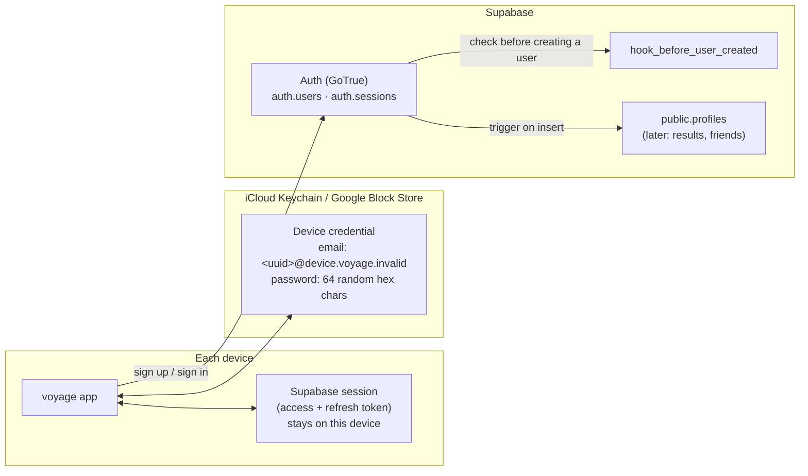
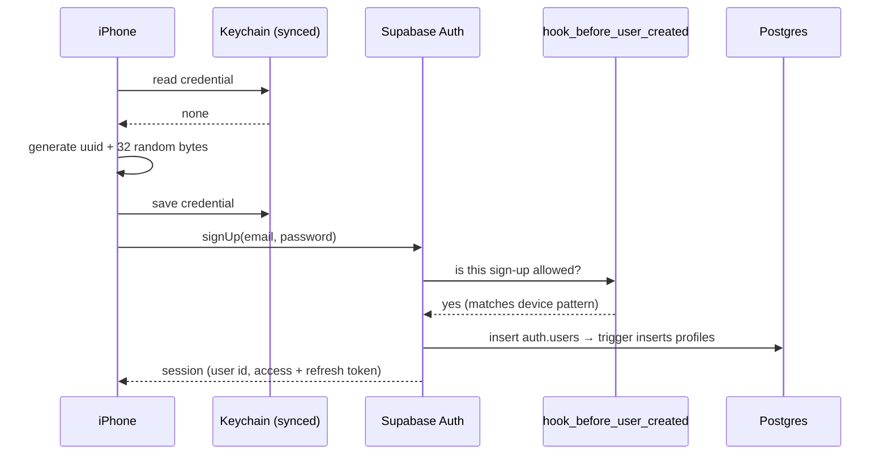
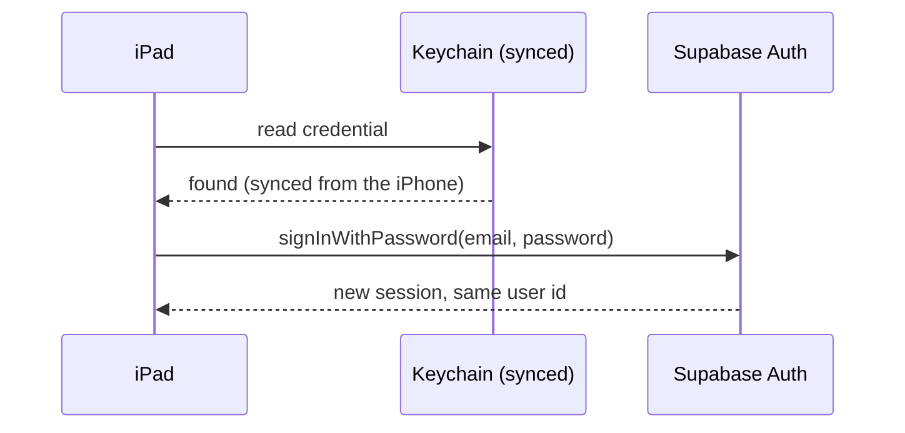
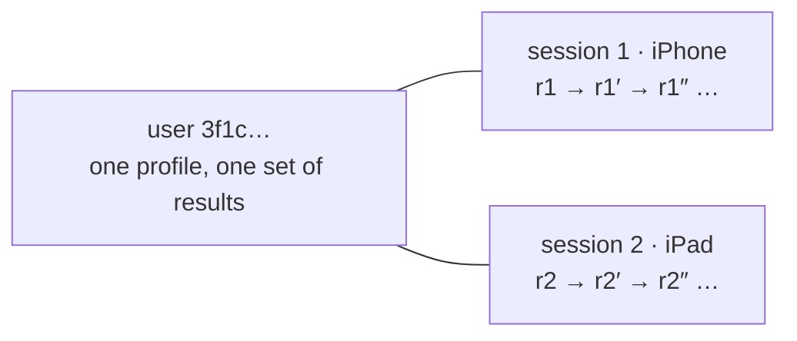
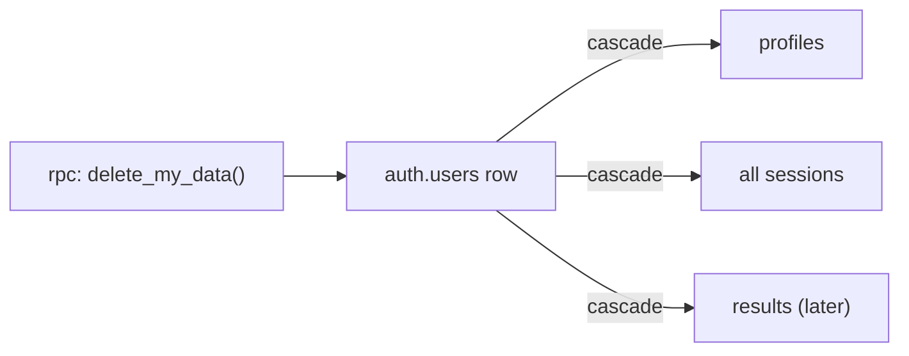

# Device identity

Daily game results are sent to Supabase without asking the player to make an
account. Each player is one Supabase user, created from a **device credential**
that the app generates and the player never sees.

> Server side: [#198](https://github.com/AnmolS99/voyage/issues/198).
> App side (generating, syncing and using the credential): [#201](https://github.com/AnmolS99/voyage/issues/201).

## The pieces



| Piece | What it is | Where |
| --- | --- | --- |
| Device credential | A generated email and password. The only thing that syncs between devices. | Synced Keychain item (iOS) or Block Store (Android) |
| Session | That device's access token (JWT, 1 h) and refresh token | The SDK's own storage, never synced |
| User | One `auth.users` row per player; its `id` keys everything else | Supabase Auth |
| Profile | One `public.profiles` row per user, readable only by that user | Postgres, RLS |

The `.invalid` top-level domain can never be a real address, so no email is
ever sent, and email confirmation is turned off.

## First device: sign up

This happens the first time the Daily tab opens with **Share daily results**
switched on.



## More devices: sign in as the same user

When the credential has synced to another device (an iPad on the same Apple
ID, or a new Android phone on the same Google account), that device signs in
with it and gets a **session of its own**.



Every sign-in creates a new row in `auth.sessions`. Each session has its own
refresh-token chain, and Supabase's refresh-token rotation and reuse detection
only compare tokens within one chain. So devices refresh on their own
schedule and never sign each other out:



**Why only the credential syncs, not the session:** if two devices shared one
session, they would share one chain. As soon as one device has refreshed
twice, the other is holding an old token. Supabase answers that with
`refresh_token_already_used` and signs that device out.

## Rules that keep this working

- **Sign out with the local scope.** The SDKs default to `global`, which ends
  every session of the user, so signing out on one device would log out the
  others.
- **Keep "Single session per user" off** in the Auth settings. It would end the
  other devices' sessions on every sign-in.
- **Only device credentials can sign up.** `hook_before_user_created` refuses
  any sign-up that isn't an email matching
  `<uuid>@device.voyage.invalid`, with 403. That rules out real addresses,
  phone and OAuth sign-ups. Passwords shorter than 32 characters get 422.
  Sign-ups are also limited to 30 per 5 minutes per IP.
- **The password is sent only twice per device:** at sign-up, or at the first
  sign-in on a new device. After that the device stays signed in with its
  refresh token.

## Deleting data

**Delete my daily data** in Settings calls `delete_my_data()`. It deletes the
caller's `auth.users` row, and Postgres cascades that to the profile, every
session and (later) every result. Then the app wipes the credential and its
local cache. The other devices' sessions stop working on their next refresh.



## Limits

- **iOS ↔ Android:** iCloud Keychain and Block Store don't talk to each other,
  so switching platforms starts a new user. Linking Sign in with Apple or Google
  ([#209](https://github.com/AnmolS99/voyage/issues/209)) fixes this later.
- **iCloud Keychain off, or no Google account:** the credential doesn't sync,
  so each device is its own user.
- **Share daily results off:** no credential is created and nothing is sent.

## Where it lives

| What | File |
| --- | --- |
| Profiles, trigger, hook, `delete_my_data` | `shared/supabase/migrations/20261123210000_create_device_identity.sql` |
| Auth settings (hook, confirmation, password length) | `shared/supabase/config.toml` (`[auth]`; production values in `[remotes.production]`) |
| Database tests | `shared/supabase/tests/device_identity_test.sql` |
| End-to-end check against a running project | `scripts/smoke_test_device_identity.py` |

```bash
supabase db start --workdir shared && supabase test db --workdir shared
```

```bash
python3 scripts/smoke_test_device_identity.py http://127.0.0.1:54321 <local publishable key>
```

The smoke test needs the full stack running (`supabase start`), not just the
database. It creates one user and deletes it again.
